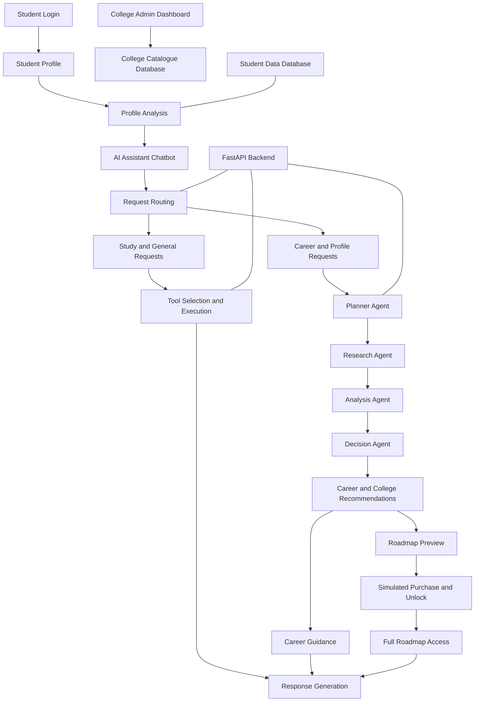

# Agent Coordination and Decision Engine

## AI Education & Career Guidance Assistant

An AI-powered education and career guidance platform that helps students analyze their academic profiles, understand their skills, explore suitable careers, discover relevant colleges, and access personalized career roadmaps.

The platform integrates a Streamlit student application, FastAPI backend, specialized AI agents, tool execution, data storage, and a college administration dashboard into one project.

##  Core Capabilities

- **Student Login:** Provides the entry point for students to access the application.
- **Profile Analysis:** Analyzes student-provided academic details, skills, and career interests.
- **AI Assistant Chatbot:** Supports student questions about education, studies, skills, and career opportunities.
- **Career Analytics:** Helps students understand skill alignment with potential career paths.
- **Career Guidance:** Provides career suggestions and recommended learning priorities.
- **College Recommendations:** Helps students explore colleges and programmes using available catalogue information.
- **Personalized Career Roadmap:** Provides roadmap previews and a purchase/unlock flow for full roadmap access.
- **College Admin Dashboard:** Supports college catalogue management through the existing administration interface.
- **Multi-Agent Workflow:** Organizes planning, research, analysis, and decision-making tasks.
- **API and Monitoring:** Provides backend endpoints and supporting monitoring capabilities.

The roadmap purchase uses a simulated ₹150 academic project payment flow; it is not represented as a live payment gateway.

##  System Architecture



### Workflow Explanation

1. **Student access:** The student opens the application and provides relevant profile information.
2. **Profile analysis:** The application evaluates the available academic details, skills, and career interests.
3. **Question processing:** The AI assistant receives student questions and routes supported requests through the appropriate backend workflow.
4. **Agent coordination:** Planning, research, analysis, and decision components process requests according to the implemented workflow.
5. **Recommendations:** The application presents relevant career guidance and college information.
6. **Roadmap access:** Students can preview the roadmap and use the simulated purchase/unlock flow for full access.
7. **Administration:** The college administration interface manages catalogue information separately from student data.

##  Multi-Agent Architecture

| Component | Responsibility |
|---|---|
| Planner Agent | Organizes incoming requests and identifies the appropriate workflow. |
| Research Agent | Retrieves relevant information from available sources. |
| Analysis Agent | Evaluates retrieved information and develops structured findings. |
| Decision Agent | Formulates recommendations and next steps. |
| Business Coordinator | Coordinates supported business-oriented workflow operations. |
| Response Generator | Formats workflow results into responses. |

The agents operate within the backend workflow. Students use the integrated assistant rather than needing separate chat interfaces for individual agents.

##  Integrated Tools

| Tool | Purpose |
|---|---|
| `data_retrieval` | Retrieves information from supported data sources. |
| `study_planner` | Supports structured study planning. |
| `calculation` | Executes supported calculation tasks. |
| Tool Registry | Maintains the registered tools available to the application. |
| Tool Selector | Supports selecting tools for relevant requests. |

Other supporting components handle API execution, career workflows, memory, monitoring, and roadmap-related operations where implemented.

##  Milestone & Requirements Verification

### Milestone 1 — Agent Environment Setup & Foundation Development

**Work completed / project components:**

- Established the Python-based application structure.
- Developed the Streamlit application foundation.
- Set up backend and agent-related modules.
- Established the foundation for AI-assisted student interaction.

**Evidence:** `website/app.py`, `enterprise-ai-agent-engine/api/main.py`, and the agent modules.

### Milestone 2 — Tool Integration & Intelligent Action Execution

**Work completed / project components:**

- Developed a tool registry and tool selection components.
- Integrated study planning, data retrieval, and calculation tools.
- Added backend endpoints for supported workflow and tool execution.
- Established tool-based request processing.

**Evidence:** `enterprise-ai-agent-engine/tools/`, `enterprise-ai-agent-engine/api/main.py`, and `enterprise-ai-agent-engine/workflows/workflow_v2.py`.

### Milestone 3 — Agent Coordination & Memory Management

**Work completed / project components:**

- Developed specialized planning, research, analysis, and decision components.
- Organized multi-agent workflow execution.
- Added memory-related components for supported context and persistence requirements.
- Connected agent workflow functionality with education and career guidance use cases.

**Evidence:** `enterprise-ai-agent-engine/agents/`, `enterprise-ai-agent-engine/workflows/workflow_v3.py`, and `enterprise-ai-agent-engine/memory_store.py`.

### Milestone 4 — Workflow Automation & Decision Intelligence + Enterprise API, Dashboard & Deployment

**Work completed / project components:**

- Developed career guidance and roadmap-related application functionality.
- Added college administration dashboard components.
- Provided FastAPI endpoints for supported backend operations.
- Included monitoring and payment-flow components.
- Prepared project documentation, evaluation materials, and submission checks.

**Evidence:** `enterprise-ai-agent-engine/api/main.py`, `enterprise-ai-agent-engine/college_admin_dashboard.py`, `enterprise-ai-agent-engine/college_dashboard.py`, and `enterprise-ai-agent-engine/monitoring.py`.

**Testing Status:** The project previously passed 18 automated tests with 0 failures. Two deprecation warnings were reported. These results confirm that the tested cases passed; they do not independently verify every end-to-end application flow or cloud deployment.

##  Technology Stack

| Layer | Technology |
|---|---|
| Frontend | Streamlit |
| Backend | Python, FastAPI, Uvicorn |
| Agent workflows | Existing agent modules and workflow components |
| Tool integration | Python-based tool registry and selector |
| Data storage | SQLite |
| Student data | `student_data.db` |
| College catalogue | `college_admin.db` |
| Testing | Pytest |
| Development | Python virtual environment, PowerShell, Git |

##  Repository Structure

```text
AI-Education-Assistant/
├── README.md
├── website/
│   ├── app.py
│   └── shared_database.py
│
├── enterprise-ai-agent-engine/
│   ├── api/
│   │   └── main.py
│   ├── agents/
│   │   ├── business_access_agent.py
│   │   ├── business_coordinator_agent.py
│   │   └── response_generator.py
│   ├── tools/
│   │   ├── study_planner_tool.py
│   │   ├── tool_registry.py
│   │   └── tool_selector.py
│   ├── workflows/
│   │   ├── workflow_v2.py
│   │   └── workflow_v3.py
│   ├── college_admin_dashboard.py
│   ├── college_dashboard.py
│   ├── memory_store.py
│   ├── monitoring.py
│   ├── payment_verification.py
│   ├── PROJECT_USAGE_GUIDE.md
│   ├── MILESTONE_3_4.md
│   ├── EVALUATION_REPORT.md
│   └── SUBMISSION_CHECKLIST.md
│
└── Supporting modules, tests,
    configuration, and data files
```

**Database separation:** `student_data.db` and `college_admin.db` serve separate purposes and must remain separate. Existing catalogue entries and student records must be preserved.

##  Local Setup & Quick Start

### 1. Open the project

```powershell
cd "C:\Users\Madhu Kiran\AI Assistance Project\AI-Education-Assistant"
```

### 2. Activate the existing virtual environment

```powershell
.\.venv\Scripts\Activate.ps1
```

### 3. Start the backend

Open a terminal:

```powershell
cd "C:\Users\Madhu Kiran\AI Assistance Project\AI-Education-Assistant\enterprise-ai-agent-engine"
python -m uvicorn api.main:app --reload --host 127.0.0.1 --port 8002
```

### 4. Start the Streamlit application

Open a second terminal:

```powershell
cd "C:\Users\Madhu Kiran\AI Assistance Project\AI-Education-Assistant"
.\.venv\Scripts\Activate.ps1
python -m streamlit run website/app.py --server.port 8501
```

Open `http://localhost:8501` in your browser.

Use the existing project configuration and installed dependencies. If the application uses different startup settings, follow its current configuration.

##  Testing and Verification

Run the available tests from the appropriate project directory:

```powershell
python -m pytest -v
```

Verify the following before final submission:

- Student login and profile analysis.
- AI assistant responses to career-related questions.
- Career analytics and guidance.
- College recommendations.
- Roadmap preview and simulated purchase/unlock flow.
- College catalogue management.
- Supported backend API endpoints.
- Preservation of existing database records.

Report the actual test results obtained during verification.

##  Data and Payment Safety

- Keep `student_data.db` and `college_admin.db` separate.
- Do not seed or overwrite the existing college catalogue without authorization.
- Preserve existing student and payment-related records.
- Describe the ₹150 purchase as a simulated academic project flow.
- Do not claim production payment processing or cloud deployment unless independently verified.

##  Project Documentation

- `README.md` — project overview, architecture, milestones, and setup.
- `PROJECT_USAGE_GUIDE.md` — application usage and demonstration instructions.
- `MILESTONE_3_4.md` — milestone-related documentation.
- `EVALUATION_REPORT.md` — recorded evaluation information.
- `SUBMISSION_CHECKLIST.md` — submission verification checklist.

##  Project Objective

To develop an AI-powered education and career guidance platform that combines specialized AI agents, intelligent tool execution, student profile analysis, career decision support, college recommendations, and personalized roadmap access in one integrated application. The system aims to help students make informed academic and career decisions while providing a dedicated interface for college catalogue administration.
